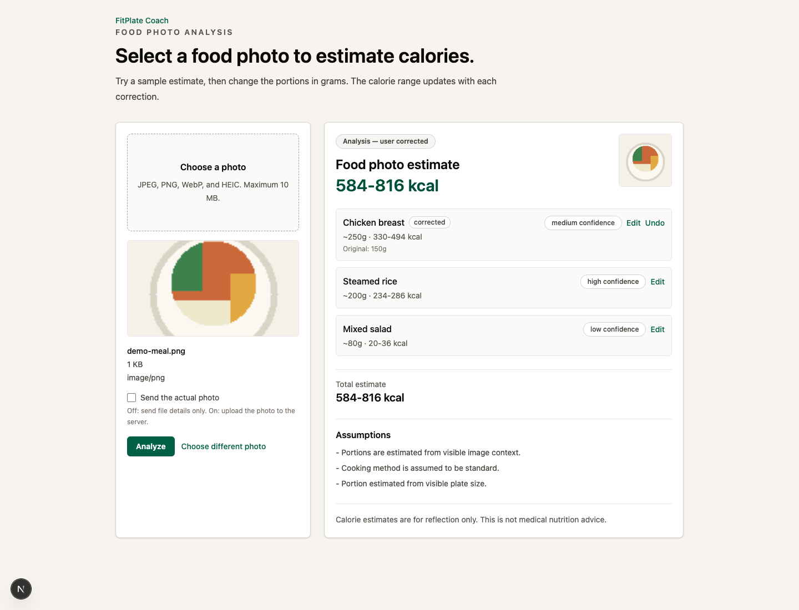

# FitPlate Coach


A food photo can show the ingredients and still hide the portion size.

FitPlate Coach lets you select a food photo, inspect estimated items and calorie ranges, and correct each portion in grams. The API recomputes the range while the interface keeps the original estimate beside your correction. The included demo uses deterministic sample estimates.

Personal project. Built with AI assistance.

[Run locally](#run-locally) · [Docs](#docs)



Local mock flow with a generated sample image and a portion correction.

## How it works

1. [food/new/page.tsx](apps/web/src/app/food/new/page.tsx) validates the image and sends file details to the metadata endpoint, or image bytes when upload is selected.
2. [routers/food.py](apps/api/app/routers/food.py) selects the analyzer and validates its [FoodAnalysis](apps/api/app/schemas/food.py) response.
3. [ResultView.tsx](apps/web/src/app/food/new/_components/ResultView.tsx) shows items, calorie ranges, confidence, and portion assumptions.
4. [FoodItemRow.tsx](apps/web/src/app/food/new/_components/FoodItemRow.tsx) submits corrected grams; the API recomputes the range from grams, calorie density, and the original confidence margin.

Mock, fake-provider, and optional real-provider paths share the response schema. A correction records both original and updated values.

## Project layout

| Path | What | Start here |
| --- | --- | --- |
| `apps/web/src/` | Food photo flow and correction UI | [Food page](apps/web/src/app/food/new/page.tsx) |
| `apps/api/app/` | Routes, schemas, analyzers, and local run logs | [Food routes](apps/api/app/routers/food.py) |
| `apps/api/tests/` | API, correction, and provider behavior | [Correction tests](apps/api/tests/test_food_corrections_mock.py) |
| `apps/web/e2e/` | Browser flow checks | [Food analysis](apps/web/e2e/food-analysis.spec.ts) |
| `docs/` | API contract, architecture, and data handling | [API contract](docs/API_CONTRACT.md) |

## Run locally

Requires Git, Node.js 22+, and Python 3.12.

```bash
git clone https://github.com/yy31104/fitplate-coach.git
cd fitplate-coach
npm ci
python3.12 -m venv apps/api/.venv
apps/api/.venv/bin/python -m pip install -e "apps/api[dev]"
```

Start the API in one terminal:

```bash
FITPLATE_AI_MODE=mock npm run dev:api
```

Start the web app in another:

```bash
npm run dev:web
```

Open [127.0.0.1:3000/food/new](http://127.0.0.1:3000/food/new), choose an image, run Analyze, then edit an item's grams. The default demo needs no API key.

Checks take about a minute after dependency installation:

```bash
npm run lint:web
npm run build:web
npm run test:api
npm run eval:api
npm run metrics:api
```

Install the browser once before running the browser checks:

```bash
npm exec --workspace apps/web playwright install chromium
npm run test:e2e
```

## Design notes

The API owns calorie recomputation. Keeping the density and confidence margin in the correction request makes the change inspectable, and the UI preserves the earlier estimate.

Pydantic models and TypeScript types share field names and a schema version. Provider-specific output is converted at the adapter boundary before the result reaches the interface.

Mock and fake providers make the correction flow and failure cases repeatable. Local model-run logs contain summary fields; uploaded images and full provider responses are excluded from those logs. See the [data map](docs/DATA_MAP.md).

## Limits

- The default demo returns sample estimates; actual image recognition requires the optional provider setup. Calorie estimates are not medical or dietary advice.
- Analyses and corrections live in browser state and disappear on reload. Grams can be corrected; food names cannot yet be changed.
- Real-provider mode sends the photo to OpenAI and incurs API costs. Its local spending check is disabled when the configured cap is zero; see the [runbook](docs/runbooks/real-ai-local.md).

## Docs

- [Architecture](docs/ARCHITECTURE.md)
- [API contract](docs/API_CONTRACT.md)
- [Data map](docs/DATA_MAP.md)
- [Evaluation workflow](docs/runbooks/eval-maintenance.md)
- [Optional real-provider setup](docs/runbooks/real-ai-local.md)
